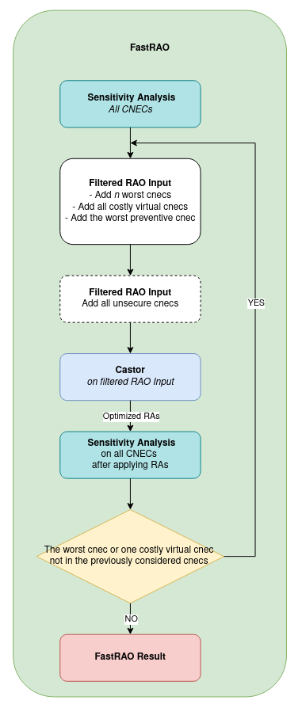

# Combining Performance and Complexity

The following sections refer to parameterizable options.

## Parallelization

There are different layers of parallelization possible in the search-tree methodology. In the current implementation
of the algorithm, the following parallelization features are all available and parameterized independently:

- Parallelization of contingency simulations:
In a security analysis, the load flow computation for all contingencies can be done in parallel. A parameter is 
available to specify how many threads are available for each security analysis. This parallelization is directly
operated by the load flow module itself. It is especially very useful for the preventive perimeter, where all
post-contingency flows must be calculated after each contingency.

- Parallelization of topological actions:
The consequences of each topological action must be evaluated independently. These evaluations can therefore be done
in parallel threads

- Parallelization of curative perimeters optimization:
After the preventive optimization finished, all the curative perimeters can be optimized independently. 
These optimization can also be done in parallel, using dedicated threads.
 
- Parallelization of studied situations (timestamps):
When performing optimization on multiple timestamps, it is also possible to separate the computation of 
the different studied situations on different threads.

---
See also: [Computations parallelism parameters](../../parameters/implementation-specific-parameters.md#multi-threading-parameters)

---

## Search-tree depth

The higher the number of critical branches, critical outages and remedial actions, the longer the calculation. 
For instance, an optimizer will try different combinations of topological actions to solve one constraint 
(RA1+RA2, RA1+RA3, RA2+RA3, RA1+RA2+RA3….). Simulating all combinations to find the best set would require 
more time than finding the first set respecting the criteria.

The complexity here can be defined as the maximal number of consecutive chosen network actions, also called search-tree depth.

For studies where complexity is high but performance is not the main priority, the search-tree depth can be configured 
accordingly in order to assess more combinations.

For operational process (such as capacity calculation/security analysis), where expectation for performance can be high, 
search-tree depth will be configured in order to match the allotted time for the calculation process.

By defining the search-tree depth as a parameter, CASTOR can be used easily in both applications.


---
See also: [Preventive search stop criterion parameters](../../parameters/implementation-specific-parameters.md#max-preventive-search-tree-depth), [Curative search stop criterion parameters](../../parameters/implementation-specific-parameters.md#max-curative-search-tree-depth)

---

## Network-action-minimum-impact-threshold

In addition to search-tree depth, the network-action-minimum-impact-threshold is also configurable to adjust the 
optimization with performance expected by the operational process. The network-action-minimum-impact-threshold 
represents the minimal relative/absolute increase of objective function between two consecutive chosen network actions.
 
This minimal relative gain is expressed as a percentage of previous objective function (0.2 for 20%). 
By setting this parameter at a higher value, this could **fasten the computation time while focusing only 
on the most efficient remedial actions**. This avoids simulating a high number of remedial actions to only have
a small gain on a single CNEC.

This parameter can be defined also through absolute increase :
- minimum impact (in MW or A) for the application of topological remedial action 
- minimum impact (in MW/degree or A/degree) for the use of PST/HVDC

---
See also: [Network actions impact parameters](../../parameters/business-parameters.md#network-actions-optimization-parameters), [Range actions impact parameters](../../parameters/business-parameters.md#range-actions-optimization-parameters)

---

## FastRAO

In general cases, network congestion varies significantly across different CNECs and states.
This variation leads to an important observation: certain CNECs consistently maintain positive security margins, regardless of which RAs are applied.
Another key observation is that running multiple RAOs on smaller subproblems is more efficient than performing a single RAO on the entire, much larger problem at once.

These insights form the foundation of FastRAO: by iteratively building and focusing only on a set of critical CNECs,
we can significantly reduce the problem's complexity, resulting in a lighter optimization problem that can be solved
faster without compromising system security.

### Algorithm

FastRAO iteratively builds a set of the **critical** CNECs. Starting with an empty set of CNECs, at each iteration,
we selectively add only the CNECs that are identified as critical for the problem.

The diagram below illustrates how the set of critical CNECs is built. In the next section, you can also find an illustration of the algorithm using a simple example.



> Currently, FastRAO does not support multi-curative optimization

#### Illustration of the algorithm

<table>
  <tr>
    <td style="vertical-align: middle; width:50%;">
      
    </td>
    <td style="vertical-align: middle; width:50%;">
    In this example, let’s consider the reachable area defined in black, RAO results indicated by a (+), and CNECs' limit represented by a line.

The system contains three types of CNECs:
- Green CNECs: Always secure and can be ignored.
- Red CNECs: Define the boundary of the secure area; these are the most relevant for the RAO.
- Purple CNECs: Hard to single out from red CNECs, as they too can become unsecure; but if a purple CNEC is unsecure, so is a red CNEC; that's why only red CNECs have an impact on the RAO.

The green area represents the secure region found after a RAO. The goal is to build a set of CNECs (ideally only the red ones)
that will lead to a solution where all CNECs are secure.

We begin by computing the margins for all CNECs via a load flow in the initial state and identify two unsecure ones to
include in the first RAO. After applying the resulting actions, we run another load flow check. The two previous CNECs
are now secure, but a new unsecure one is found. This loop continues: running RAO, applying results, and checking
all CNECs until all are secure.
</td>
  </tr>
</table>

### How to run an optimization process using FastRAO

```java
// Make sure to add FastRaoParameters extension to your raoParameters
FastRaoParameters fastRaoParameters = new FastRaoParameters();
raoParameters.addExtension(FastRaoParameters.class, fastRaoParameters);

// Run 
RaoInput raoInput = RaoInput.build(network, crac).build();
RaoResult raoResult = Rao.find("FastRao").run(raoInput, raoParameters);

// Run FastRAO with a predefined set of CNECs to consider
FastRao.launchFilteredRao(raoInput, raoParameters, targetEndInstant, consideredCnecs);
```

---
[](../../parameters/implementation-specific-parameters.md#number-of-cnecs-to-add)
See also [FastRAO parameters section](../../parameters/implementation-specific-parameters.md#number-of-cnecs-to-add)

---

## DC pre-solve

The search-tree runs a sensitivity analysis for each network action combination it tests, and again at each iteration
of the [linear optimization](linear-problem.md) of range actions. Sensitivity analysis is much faster in DC than in AC.

The DC pre-solve is an optional feature: it is disabled unless the `pre-solve-parameters` block is added to the
`open-rao-search-tree-parameters` extension (see [Pre-solve optional parameter](../../parameters/implementation-specific-parameters.md#pre-solve-optional-parameter)).
When the DC pre-solve is enabled for an instant, each perimeter of this instant is optimized in two steps:

1. **DC search-tree**: a complete search-tree is run with DC sensitivities, with its own maximum depth. It returns a
   network action combination, called the DC solution.
2. **AC search-tree**: the usual search-tree is run with the AC sensitivities, using the DC solution in one of
   two ways:
   - **HINT**: the DC solution is added to the combinations of the first depth, like a
     [predefined combination](../../parameters/implementation-specific-parameters.md#predefined-combinations), and is
     evaluated first. If it satisfies the stop criterion in AC, the search can stop early.
   - **FORCED**: the DC solution is the only combination tested at the first depth. The next depths are explored as
     usual, starting from the DC solution. This is faster, since the first depth only
     contains one leaf, but other combinations of the first depth are never tested.

The root leaf always remains a candidate: if the DC solution is worse than the initial situation in AC, or if its load
flow does not converge, it is discarded. If the DC solution contains no network action, the AC search-tree runs as
without DC pre-solve.

The table below shows how to configure the main behaviors, for preventive and curative instants independently:

| Behaviour                                      | DC depth | DC solution usage | AC depth |
|------------------------------------------------|----------|-------------------|----------|
| No DC pre-solve                                | 0        | any               | any      |
| AC search-tree guided by the DC solution       | ≥ 1      | HINT              | ≥ 1      |
| DC solution compared with the root leaf only   | ≥ 1      | FORCED            | 1        |
| DC solution as first depth, then AC search     | ≥ 1      | FORCED            | ≥ 2      |

The DC pre-solve has no effect if the sensitivity parameters are already in DC, or if the CRAC contains no network
action (the search-tree only branches over network actions).

When the DC pre-solve is enabled, an initial sensitivity analysis is also run in DC, to give the DC search-trees their
reference flows. If it fails, the DC pre-solve is disabled for the whole RAO, which then runs in AC only. A warning is
logged.

> ⚠️ **Warning**  
> DC sensitivity analysis does not model HVDC lines in AC emulation mode (see
> [HVDC](special-features/hvdc.md#additional-warnings)). The DC solution may then be less relevant, but the AC
> search-tree still evaluates it with the AC model.

---
See also: [DC pre-solve parameters](../../parameters/implementation-specific-parameters.md#pre-solve-optional-parameter)

---
