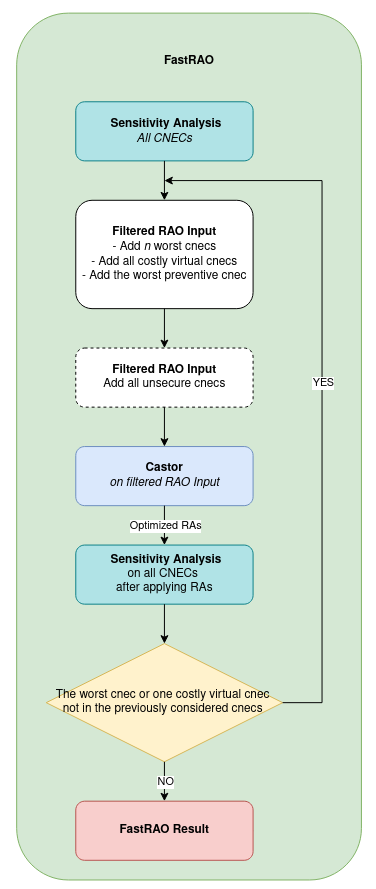

# Combining Performance and Complexity

The following sections refer to parameterizable options.

## Parallelization

There are different layers of parallelization possible in the search-tree methodology. In the current implementation
of the algorithm, the following parallelization features are all available and parameterized independently:

- Parallelization of contingency simulations:
In a security analysis, the load-flow computation for all contingencies can be done in parallel. A parameter is 
available to specify how many threads are available for each security analysis. This parallelization is directly
operated by the load-flow module itself. It is especially very useful for the preventive perimeter, where all
post-contingency flows must be calculated after each contingency.

- Parallelization of topological actions:
The consequences of each topological action must be evaluated independently. These evaluations can therefore be done
in parallel threads

- Parallelization of curative perimeters optimisation:
After the preventive optimisation finished, all the curative perimeters can be optimised independently. 
These optimisations can also be done in parallel, using dedicated threads.
 
- Parallelization of studied situations (timestamps):
When performing optimisation on multiple timestamps, it is also possible to separate the computation of 
the different studied situations on different threads.

---
See also: [Computations parallelism parameters](../../parameters/implementation-specific-parameters.md#multi-threading-parameters)

---

## Search-tree depth

The higher the number of critical branches, critical outages and remedial actions, the longer the calculation. 
For instance, an optimiser will try different combinations of topological actions to solve one constraint 
(RA1+RA2, RA1+RA3, RA2+RA3, RA1+RA2+RA3….). Simulating all combinations to find the best set would require 
more time than finding the first set respecting the criteria.

The complexity here can be defined as the maximal number of consecutive chosen network actions, also called search-tree depth.

For studies where complexity is high but performance is not the main priority, the search-tree depth can be configured 
accordingly in order to assess more combinations.

For operational process (such as capacity calculation/security analysis), where expectation for performance can be high, 
search-tree depth will be configured in order to match the allotted time for the calculation process.

By defining the search-tree depth as a parameter, CASTOR can be used easily in both applications.


---
See also: [Preventive search stop criterion parameters](../../parameters/implementation-specific-parameters.md#max-preventive-search-tree-depth), [Curative search stop criterion parameters](../../parameters/implementation-specific-parameters.md#max-curative-search-tree-depth)

---

## Network-action-minimum-impact-threshold

In addition to search-tree depth, the network-action-minimum-impact-threshold is also configurable to adjust the 
optimisation with performance expected by the operational process. The network-action-minimum-impact-threshold 
represents the minimal relative/absolute increase of objective function between two consecutive chosen network actions.
 
This minimal relative gain is expressed as a percentage of previous objective function (0.2 for 20%). 
By setting this parameter at a higher value, this could **fasten the computation time while focusing only 
on the most efficient remedial actions**. This avoids simulating a high number of remedial actions to only have
a small gain on a single CNEC.

This parameter can be defined also through absolute increase :
- minimum impact (in MW or A) for the application of topological remedial action 
- minimum impact (in MW/degree or A/degree) for the use of PST/HVDC

---
See also: [Network actions impact parameters](../../parameters/business-parameters.md#network-actions-optimisation-parameters), [Range actions impact parameters](../../parameters/business-parameters.md#range-actions-optimisation-parameters)

---

## FastRAO

In general cases, network congestion varies significantly across different CNECs and states.
This variation leads to an important observation: certain CNECs consistently maintain positive security margins, regardless of which RAs are applied.
Another key observation is that running multiple RAOs on smaller subproblems is more efficient than performing a single RAO on the entire, much larger problem at once.

These insights form the foundation of FastRAO: by iteratively building and focusing only on a set of critical CNECs,
we can significantly reduce the problem's complexity, resulting in a lighter optimization problem that can be solved
faster without compromising system security.

### Algorithm

FastRAO iteratively builds a set of the **critical** CNECs. Starting with an empty set of CNECs, at each iteration,
we selectively add only the CNECs that are identified as critical for the problem.

The diagram below illustrates how the set of critical CNECs is built. In the next section, you can also find an illustration of the algorithm using a simple example.



> Currently, FastRAO does not support multi-curative optimization

#### Illustration of the algorithm

<table>
  <tr>
    <td style="vertical-align: middle; width:50%;">
      
    </td>
    <td style="vertical-align: middle; width:50%;">
    In this example, let’s consider the reachable area defined in black, rao results indicated by a (+), and CNECs' limit represented by a line.

The system contains three types of CNECs:
- Green CNECs: Always secure and can be ignored.
- Red CNECs: Define the boundary of the secure area; these are the most relevant for the RAO.
- Purple CNECs: Hard to single out from red CNECs, as they too can become unsecure; but if a purple CNEC is unsecure, so is a red CNEC; that's why only red CNECs have an impact on the RAO.

The green area represents the secure region found after a RAO. The goal is to build a set of CNECs (ideally only the red ones)
that will lead to a solution where all CNECs are secure.

We begin by computing the margins for all CNECs via a loadflow in the initial state and identify two unsecure ones to
include in the first RAO. After applying the resulting actions, we run another loadflow check. The two previous CNECs
are now secure, but a new unsecure one is found. This loop continues: running RAO, applying results, and checking
all CNECs until all are secure.
</td>
  </tr>
</table>

### How to run an optimization process using FastRAO

```java
// Make sure to add FastRaoParameters extension to your raoParameters
FastRaoParameters fastRaoParameters = new FastRaoParameters();
raoParameters.addExtension(FastRaoParameters.class, fastRaoParameters);

// Run 
RaoInput raoInput = RaoInput.build(network, crac).build();
RaoResult raoResult = Rao.find("FastRao").run(raoInput, raoParameters);

// Run FastRAO with a predefined set of CNECs to consider
FastRao.launchFilteredRao(raoInput, raoParameters, targetEndInstant, consideredCnecs);
```

---
[](../../parameters/implementation-specific-parameters.md#number-of-cnecs-to-add)
See also [FastRAO parameters section](../../parameters/implementation-specific-parameters.md#number-of-cnecs-to-add)

---

## Optimizing the search-tree in DC

Sensitivity analysis (used to compute flows, margins and PTDFs) can be run in AC or DC. DC is significantly cheaper to
compute than AC. The search-tree algorithm calls sensitivity analysis repeatedly: once per candidate network-action 
combination, and again at every iteration of the [linear optimization](linear-problem.md) while tuning range actions. This makes it 
the main driver of a RAO run's sensitivity-analysis cost.

The [`optimize-in-dc`](../../parameters/implementation-specific-parameters.md#optimize-in-dc) parameter lets the
*search* (deciding which remedial actions to activate) run on DC sensitivities for speed, while everything the RAO
actually reports — the initial state, the post-PRA state, the final curative state — is still computed and validated in
AC. In other words, DC is used to narrow down *which* remedial actions to try, and AC is used to confirm and refine the
result before it is trusted.

### Decide in DC, recompute in AC

At every perimeter that gets optimized (preventive, each curative perimeter, second preventive), the same two-step
pattern is applied:

1. **Decide in DC**: a full search-tree run (network-action search and range-action optimization) against a DC-cloned
   copy of the RAO's sensitivity/load-flow parameters.
2. **Recompute in AC**: the *decided* network-action combination (topology is now frozen) is re-optimized against the
   caller's original AC parameters — range-action setpoints only — warm-started with the DC-decided setpoints. This is
   implemented as a dedicated leaf-only re-optimization.

If `optimize-in-dc` is not set, or if the caller's sensitivity parameters are already in DC, there is nothing to
accelerate: every "DC vs AC" branch above collapses to a no-op and the RAO behaves exactly as it did before this
mechanism existed.

### Implementation notes

- **One extra network variant, not a second network.** DC and AC results need separate network *variants* (so that
  remedial-action application in one doesn't leak into the other), not separate `Network` objects.
- **The initial sensitivity analysis runs twice, with a fail-safe.** The AC initial sensitivity analysis (over the whole
  CRAC) always runs, since it seeds the MNEC/loop-flow constraints and the baseline cost. When `optimize-in-dc` is
  active, a second, DC initial sensitivity analysis also runs, to give the DC searches their own reference point (a DC
  search compared against an AC reference would read distorted margins). If that DC analysis fails, the mechanism is
  disabled for the rest of the run and the RAO proceeds AC-only — a broken DC load-flow degrades performance, not
  correctness.
- **Warm-starting the AC recompute.** Only range-action setpoints that actually changed between the DC decision and the
  pre-perimeter situation are re-applied (applying an HVDC range action's setpoint unconditionally would disable its AC
  emulation even when the value is unchanged, silently altering the network). Leaf optimization is skipped entirely if
  the DC leaf's stop criterion was already met with no range action activated, mirroring the rule the DC search itself
  applies to its own leaves.
- **Security escalation.** If "DC said this combination is secure, but it isn't in AC":
    1. If the AC recompute of the DC-decided combination is not secure, the DC search is re-run exhaustively (ignoring
       its stop criterion) to look for a combination that both searches agree is secure.
    2. If the AC recompute of that exhaustive DC result is still not secure, a full AC search is run for the perimeter
       as a last resort.

---
See also: [`optimize-in-dc` parameter](../../parameters/implementation-specific-parameters.md#optimize-in-dc)

---

