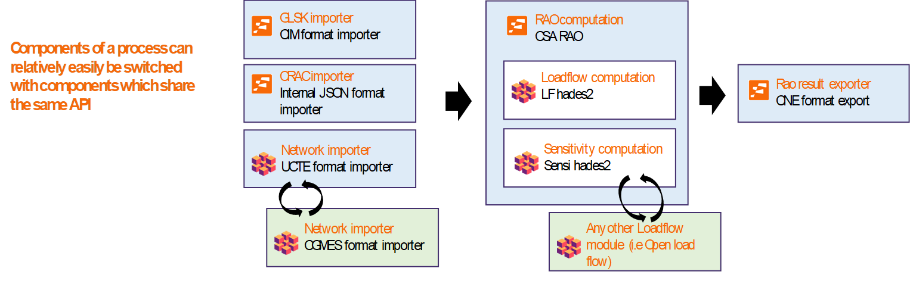
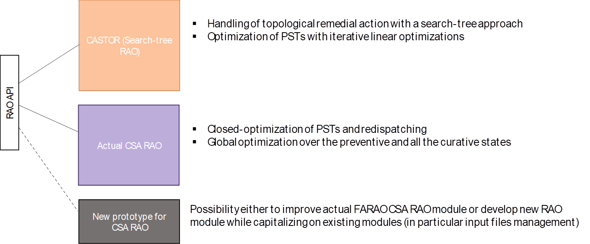

```{toctree}
---
caption: Contents of this website
maxdepth: 3
hidden: true
---

getting-started.md
glossary.md
input-data.md
output-data.md
algorithms.md
parameters.md
applications.md
```


# What is OpenRAO?

OpenRAO stands for "*Open Remedial Actions Optimizer*". It is an open-source
toolbox that aims to provide a modular engine for remedial actions optimization
and an efficient solution for electrical power systems' Coordinated Capacity Calculation,
Local Security Analysis, and Coordinated Security Analysis...

OpenRAO is a [PowSyBl](https://www.powsybl.org) based toolbox that provides software
solutions for power systems coordinated capacity calculation and security analysis projects.
It is published on [GitHub](https://github.com/powsybl/powsybl-open-rao) under the [Mozilla Public License 2.0](https://www.mozilla.org/en-US/MPL/2.0/).

# Why choose OpenRAO?

Because we are convinced that sharing our expertise and knowledge is the most efficient way for
a successful energy transition and creation of a common European market. By contributing to OpenRAO,
all can benefit from this collaborative project amongst different national expertise on system operation,
without neglecting national specificities due to structural differences in network development between countries.

Results of remedial actions optimization strongly impact socio-economic welfare and congestion costs.

How remedial actions are optimized can:
- spare TSOs the need to invest in new infrastructure
- improve market price formation and contribute to price convergence in the long term
- ease the integration of renewable energies
- reduce the costs due to national tariffs

By providing a modular and open-source tool, OpenRAO aims to:
- increase the global socio-economic welfare
- reduce redispatching/countertrading costs
- ease monitoring by national and European regulatory authorities by offering a transparent implementation
  of the approved methodologies

Unlike tools developed as a "black box", any interested actor can ensure its specifications are properly implemented;
this also helps operators make this tool their own.

Due to multiple specificities between Capacity Calculation Regions and/or control areas in terms of remedial actions,
OpenRAO offers a highly configurable solution and a collaborative approach where any actor (TSOs, NRAs, universities...)
can contribute to improve the tool for the benefit of the European community or adapt it to their local specificities.

The application of OpenRAO is not limited to Regional Coordination Center services, namely Coordinated Capacity
Calculation and Coordinated Security Analysis. It could also be used by TSOs for local Security Analysis (for instance,
local validation of the 70% margin required by the Clean Energy Package) or studies related to bidding zone review.

Transparency is in the DNA of this project. Functional and technical specifications, project's roadmap, code and its
level of quality are available on the website and updated frequently.

As ENTSO-E stated in its 2020 [Annual Work Programme](https://eepublicdownloads.entsoe.eu/clean-documents/Publications/ENTSO-E%20general%20publications/200217_ENTSO-E_Annual%20Work%20Programme%202020%20(final).pdf):

> The future of regional TSO coordination and focus of the RCCs in the next years will be strongly driven by
> the integration of costly remedial actions in complex capacity calculation methodologies [...].
>
> Transparency and timely implementation of the [...] Network Codes are seen as paramount for
> achieving the optimal integration of the European market.

# Functional overview

The [OpenRAO toolbox](https://github.com/powsybl/powsybl-open-rao) functional scope is structured along three main development axes:

- Business data modeling - providing a Java modeling of all the business objects
for power systems coordinated capacity calculation and security analysis projects.
- Computation engines - providing an open interface and efficient implementation of standard
tools for supporting capacity calculation projects.
- Exchange standards interface - providing importers and exporters to support ENTSO-E exchange
data interfaces in project implementations.    

By extending the [PowSyBl](https://www.powsybl.org) framework, OpenRAO aims to provide an open, transparent,
and extendable implementation of the tools used for an efficient usage of the electricity transmission
and distribution system.


Thanks to our modular architecture, implementing a new process in existing RAO modules or creating a new RAO based on an existing input format is accelerated (see concrete example below):

{.forced-white-background}


Benefit from our platform for optimization with different methodologies already implemented for CACM/SO methodologies. Moreover, it is possible to contribute by adding your features/improvements in existing RAO modules and creating new ones if needed.

{.forced-white-background}

# Under the hood

OpenRAO is based on high-quality open-source frameworks.

{.main-page-logo}

[PowSyBl](https://www.powsybl.org/) is an open-source Java library to assemble applications
for electrical power systems' simulation and analysis. This project is part of Linux Foundation
[LF Energy initiative](https://www.lfenergy.org/). Thanks to its internal IIDM format, OpenRAO is
natively compatible with both UCTE and CGMES network formats.

{.main-page-logo}

[OR-Tools](https://developers.google.com/optimization) is an open-source software suite for
optimization, tuned for tackling the world's toughest problems in vehicle routing, flows,
integer and linear programming, and constraint programming.
The choice of Google OR-Tools was driven by its broad compatibility with most existing open-source and commercial solvers,
including commercial solvers such as Gurobi and Xpress when high performance is required.
